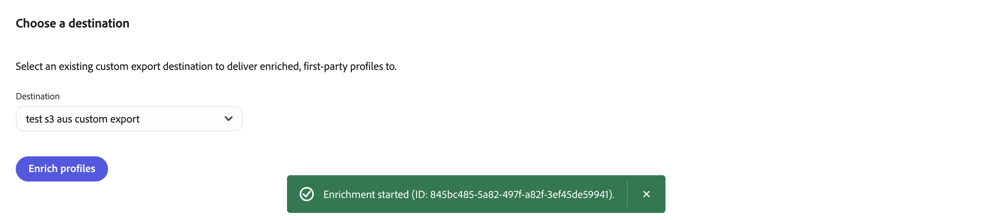

# 交易櫃檯設定檔擴充(Alpha)

使用來自[!DNL The Trade Desk]的原始事件資料流(REDS)曝光記錄資料摘要，將擴充屬性和付費媒體內容匯出至您的第一方設定檔。

CSV檔案到達[!DNL Amazon S3]匯出目的地後，將其擷取到[!DNL Adobe Real-Time CDP]。 在此版本中，匯出檔案不會自動更新設定檔或啟動體驗。 [!DNL Adobe Real-Time CDP]中的自動設定檔擴充已計畫於後續發行中進行。

廣告曝光度可將內容新增至客戶設定檔。 它不會確認參與、購買意圖或長期興趣。

## 準備擴充 {#prepare-for-enrichment}

開始之前，請與管理員、媒體團隊和資料團隊合作，確保您具備：

* 存取[!DNL Adobe Real-Time CDP Collaboration]及已簽署的參與協定。
* 已完成存取信函，[!DNL The Trade Desk]可授權REDS摘要布建。
* [!DNL Adobe Real-Time CDP Collaboration]中可使用雜湊電子郵件地址或雜湊電話號碼的第一方對象。 此版本不支援其他識別碼。
* 設定為接收擴充輸出的[!DNL Amazon S3]目的地。
* 將傳遞的檔案擷取到[!DNL Adobe Real-Time CDP]的程式。

### 授權來源摘要 {#authorize-source-feed}

若要授權REDS記錄直接傳送至Adobe，請完成[!DNL The Trade Desk]提供的存取信件。

[!DNL The Trade Desk]布建來源摘要，且Adobe會設定存取和擷取。 建立專案之前，請確認連線作用中且摘要已準備就緒。

處理之後，擴充輸出檔案會抵達您的匯出目的地。

### 準備下游擷取 {#prepare-downstream-ingestion}

傳送後，請要求您的[!DNL Adobe Real-Time CDP]系統管理員或技術支援團隊擷取檔案。

## 連線和建立專案 {#connect-create-projects}

完成連線對話方塊中的存取信函，並儲存您的合作夥伴ID。 在建立專案之前，請等候Adobe確認已收到REDS記錄。 建立專案會開始擴充工作，而這需要您的合作夥伴ID和記錄。

### 與合作夥伴連結 {#connect-partner}

若要與[!DNL The Trade Desk]連線，請在&#x200B;**[!UICONTROL 連線]**&#x200B;中開啟&#x200B;**[!UICONTROL 探索共同作業人員]**&#x200B;並搜尋夥伴。

![Collaborator目錄列出[!DNL The Trade Desk]及其[!UICONTROL 連線]選項。](../../../assets/collaborate/advertising-platforms/discover-collaborators-trade-desk.png){zoomable="yes"}

選取[!DNL The Trade Desk]的&#x200B;**[!UICONTROL 連線]**，然後遵循連線對話方塊中的指示。

![連線對話方塊說明[!DNL The Trade Desk].](../../../assets/collaborate/advertising-platforms/trade-desk-connection-instructions.png){zoomable="yes"}的REDS授權和合作夥伴ID設定

連線啟動之後，請開啟&#x200B;**[!UICONTROL 連線設定]**&#x200B;並移至&#x200B;**[!UICONTROL 廣告商資訊]**。 若要更新現有資訊，請選取&#x200B;**[!UICONTROL 編輯]**。 若要輸入新資訊，請選取&#x200B;**[!UICONTROL 新增]**。

![使用中的連線設定顯示[!UICONTROL 廣告商資訊]和[!UICONTROL 編輯]控制項。](../../../assets/collaborate/advertising-platforms/trade-desk-connection-settings.png){zoomable="yes"}

若要儲存您的廣告商資訊，請在&#x200B;**[!UICONTROL 合作夥伴ID]**&#x200B;和&#x200B;**[!UICONTROL 合作夥伴名稱]**&#x200B;中輸入識別碼和合作夥伴名稱，然後選取&#x200B;**[!UICONTROL 儲存]**。 您的合作夥伴ID出現在您[!DNL The Trade Desk]帳戶中的&#x200B;**[!UICONTROL 名額識別碼]**&#x200B;下。

![「廣告商資訊」對話方塊必須有「合作夥伴識別碼」和「合作夥伴名稱」欄位，以及[!UICONTROL 儲存]控制項。](../../../assets/collaborate/advertising-platforms/trade-desk-advertiser-partner-info-dialog.png){zoomable="yes"}

儲存廣告商資訊後，請等候Adobe確認收到REDS記錄再建立專案。

### 建立專案 {#create-project}

若要建立專案，請移至&#x200B;**[!UICONTROL 共同作業]**&#x200B;並選取&#x200B;**[!UICONTROL 我的專案]**，然後&#x200B;**[!UICONTROL 建立專案]**&#x200B;或新增圖示（）。

在&#x200B;**[!UICONTROL 建立專案]**&#x200B;中，從&#x200B;**[!UICONTROL 共同作業人員]**&#x200B;中選取[!DNL The Trade Desk]。

![&#x200B; [!UICONTROL 建立專案]表單列出[!DNL The Trade Desk]，並包含專案名稱、說明和影像欄位。](../../../assets/collaborate/advertising-platforms/trade-desk-create-project.png){zoomable="yes"}

若要識別專案，請輸入&#x200B;**[!UICONTROL 專案名稱]**&#x200B;和&#x200B;**[!UICONTROL 描述]**，然後選取影像。 專案詳細資料完成時，選取&#x200B;**[!UICONTROL 建立]**。

如需一般專案管理，請參閱[建立及管理專案指南](/help/guide/collaborate/manage-projects.md)。

## 選取和匯出屬性 {#select-export-attributes}

若要選取要匯出的擴充屬性，請開啟專案並選取&#x200B;**[!UICONTROL 擴充]**。 若要瞭解訊號可用性，請先檢閱每個屬性的涵蓋範圍值，再選取您要使用的屬性。

![&#x200B; [!UICONTROL 擴充]頁面會依類別將可選取的訊號分組，並顯示涵蓋範圍值。](../../../assets/collaborate/advertising-platforms/enrich-attribute-selection.png){zoomable="yes"}

<!-- TODO: Replace the destination screenshot with one showing the [!UICONTROL Export Attributes] action. -->

選取為擴充輸出設定的[!DNL Amazon S3]匯出目的地。 如果您需要設定目的地，請參閱[設定和管理雲端儲存體目的地](/help/guide/destinations/manage-destinations.md)。

<!-- ![The [!UICONTROL Choose a destination] screen lists a destination and the [!UICONTROL Export Attributes] action.](../../../assets/collaborate/advertising-platforms/enrich-choose-destination.png){zoomable="yes"} -->

檢閱選取的屬性和目的地，然後選取&#x200B;**[!UICONTROL 匯出屬性]**。

<!-- {zoomable="yes"} -->

如果您的目的地設定正確，則提交匯出會開始傳遞。 在您提交匯出之後，請在[!DNL Adobe Real-Time CDP Collaboration]之外驗證檔案傳送是否成功。

Adobe會在您建立專案時處理擴充屬性，然後每週處理。 每次執行都使用過去90天的可用[!DNL The Trade Desk]資料。 每次匯出都會包含您從最近完成的回合中選取的屬性。 若要匯出重新整理的屬性，請在稍後執行完成後要求另一次匯出。

### 可用的擴充訊號 {#available-signals}

從四個類別中的18個已組織的訊號中選取。 不支援自訂擴充運算式。

| 類別 | 訊號 | 說明 |
| --- | --- | --- |
| 核心 | [!UICONTROL 上次公開日期] | 最近向廣告公開身分的日期。 |
| 核心 | [!UICONTROL 曝光計數] | 曝光頻率類別，而不是原始曝光計數。 |
| 核心 | [!UICONTROL 正在尋找與重新目標定位] | 推斷出的曝光類別，代表潛在客戶或再行銷。 |
| 核心 | [!UICONTROL 顯示的產品類別] | 在廣告中促銷的推斷產品類別。 |
| 核心 | [!UICONTROL 主要詳細目錄管道] | 與廣告曝光度相關的主要詳細目錄管道。 |
| 核心 | [!UICONTROL 主要裝置型別] | 和廣告曝光度相關聯的主要裝置型別。 |
| Geography | [!UICONTROL 城市] | 衍生自廣告內容的城市資訊，而非已驗證的位置。 |
| Geography | [!UICONTROL 地區/州] | 來自廣告內容的地區或州資訊。 |
| Geography | [!UICONTROL DMA] | 從廣告內容衍生的指定市場區域(DMA)資訊。 |
| 連線電視(CTV) | [!UICONTROL CTV已公開] | 已連線電視裝置上的廣告曝光。 |
| 連線電視(CTV) | [!UICONTROL 即時資料流檢視器] | 直播串流詳細目錄中的廣告曝光，而不是檢視或參與的證據。 |
| 連線電視(CTV) | [!UICONTROL PMP /進階曝光] | 私人商場(PMP)或私人合約風險，而非經過獨立驗證的優質存貨。 |
| 內容相似性 | [!UICONTROL 連線電視/串流] | 和串流內容相關的廣告曝光。 |
| 內容相似性 | [!UICONTROL 遊戲玩家] | 和遊戲內容、網站或應用程式相關的廣告曝光。 |
| 內容相似性 | [!UICONTROL 運動粉絲] | 和體育內容、網站或應用程式相關的廣告曝光。 |
| 內容相似性 | [!UICONTROL 新聞追隨者] | 與新聞內容、網站或應用程式相關的廣告曝光。 |
| 內容相似性 | [!UICONTROL 音樂愛人] | 和音樂內容、網站或應用程式相關的廣告曝光。 |
| 內容相似性 | [!UICONTROL 內容型別] | 和廣告曝光度相關的內容型別。 |

地理訊號會說明廣告內容，而非已驗證的住家或目前位置。 內容相關性訊號無法確認個人的興趣或喜好設定。 當來源資訊無法使用時，某些屬性可能不包含值。

### 屬性涵蓋範圍 {#attribute-coverage}

涵蓋範圍說明處理記錄中包含屬性值的頻率。 對於yes/no訊號（例如&#x200B;**[!UICONTROL CTV exposed]**），涵蓋範圍會以true值計算記錄。 涵蓋範圍不會指出身分符合率，或是接收屬性的第一方設定檔比例。

身分比對、來源訊號可用性以及擷取會影響設定檔更新。 涵蓋範圍無法確認匯出完成或設定檔更新。

### 工作流程範圍 {#workflow-scope}

若要擴充[!DNL The Trade Desk]的資料，請使用已組織的目錄。 您無法匯出原始記錄檔或建立自訂屬性運算式。 不支援其他需求端平台(DSP)和供應端平台(SSP)整合。

此工作流程不支援擴充機會探索、對象重疊分析或歸因和增量測量。

## 擷取及驗證結果 {#ingest-validate-results}

傳送後，請要求您的[!DNL Adobe Real-Time CDP]系統管理員或技術支援團隊擷取檔案。

### 輸出檔案 {#output-file}

匯出會將CSV檔案傳送到您設定的[!DNL Amazon S3]目的地。

<!-- 
TODO: replace this placeholder with the engineering-confirmed output specification:
* Required hashing and normalization for each identifier, including whether email requires SHA-256 after trimming and lowercasing.
* Exact CSV headers, the file naming pattern, and the delivery bucket and path.
* Each identifier column in the delivered file and the identity namespace to map that column to during ingestion.
Do not treat example formats or supported input match keys as confirmed output requirements.
-->

驗證是否與設定檔更新分開匯出：

1. 確認CSV檔案已到達預期的[!DNL Amazon S3]位置。
1. 檢查檔案是否包含預期的識別碼和選取的屬性。
1. 針對目標沙箱和資料集，使用已確認的身分和結構描述對應來內嵌檔案。
1. 檢閱擷取結果，並確認預期設定檔的範例包含擴充屬性。

匯出檔案不會確認擷取已更新設定檔。 若要更新設定檔，請擷取稍後分別匯出的設定檔。

## 疑難排解擴充 {#troubleshoot-enrichment}

若要疑難排解來源資料、匯出和擷取問題，請使用下列檢查：

| 問題 | 檢查內容 |
| --- | --- |
| 無法使用連線或&#x200B;**[!UICONTROL 擴充]** | 請要求您的管理員確認您的連線和專案存取權。 確認來源摘要設定已完成。 |
| 沒有可用的匯出目的地 | 請要求您的管理員確認目的地已設定且可用於擴充輸出。 |
| 屬性的涵蓋範圍有限 | 與您的媒體團隊一起檢閱來源資料可用性。 請勿將涵蓋範圍解讀為設定檔符合率。 |
| 已要求匯出，但檔案不存在 | 與您的資料團隊確認預定目的地。 請求提交未確認傳遞。 |
| 傳遞的檔案未更新設定檔 | 檢閱擷取結果，並確認身分和結構描述對應。 匯出和內嵌是不同的操作。 |
| 您無法要求匯出 | 請至少選取一個屬性和目的地。 如果匯出已在處理中，請等到匯出完成再請求其他匯出。 |
| 涵蓋範圍很高，但很少有設定檔會接收屬性 | 涵蓋範圍不是身分符合率。 確認來源摘要準備就緒，對象使用支援的相符金鑰，且您的身分對應在擷取期間正確無誤。 |
| 建立專案後，不會顯示任何屬性或涵蓋範圍 | 專案設定會在您建立時修正。 如果Adobe當時沒有從[!DNL The Trade Desk]收到您的REDS記錄，專案稍後將無法使用。 Adobe確認收到記錄後，請建立新專案。 |
| 設定檔有屬性，但受眾或體驗不會反映這些屬性 | 檢查對象評估、身分、同意和下游體驗鎖定目標規則。 |

## 後續步驟 {#next-steps}

在您內嵌及驗證屬性後，結合擴充訊號與第一方資料，在[!DNL Adobe Real-Time CDP]中建立對象。 如需詳細資訊，請參閱[對象產生器指南](https://experienceleague.adobe.com/zh-hant/docs/experience-platform/segmentation/ui/audience-builder){target="_blank"}。

若要針對目的地、個人化或客戶歷程啟用對象，請參閱[對象啟用指南](https://experienceleague.adobe.com/zh-hant/docs/experience-platform/destinations/ui/activate/activation-overview){target="_blank"}。
