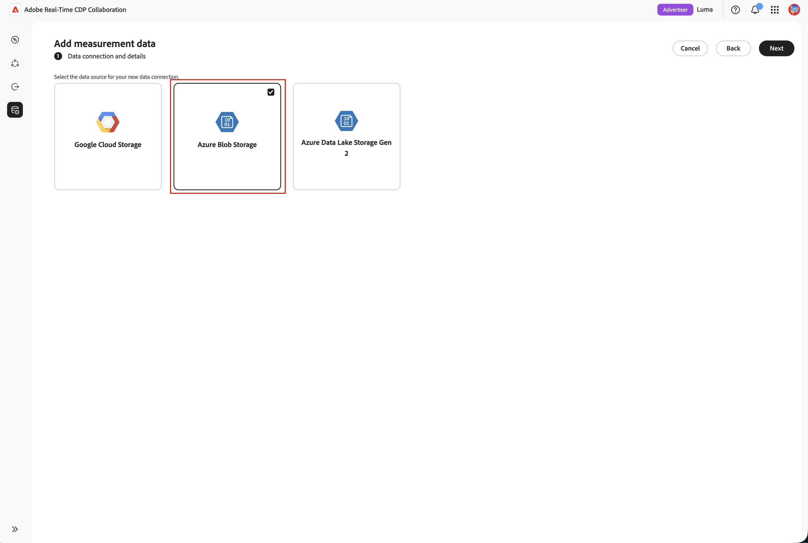

# 設定[!DNL Azure]儲存空間用於廣告曝光來源

將您的[!DNL Azure Data Lake Storage]或[!DNL Azure Blob Storage]帳戶連線至Adobe Real-Time CDP Collaboration，以取得測量的廣告曝光（廣告記錄）資料。

Real-Time CDP Collaboration中的Measurement模組會將廣告商轉換資料與發佈者廣告曝光記錄檔連線起來，以提供以隱私權為中心的促銷活動報告。 這為廣告商和發佈商新增了自助服務的無程式碼路徑。 您可以將您在[!DNL Azure]中已保留的廣告曝光（印象）記錄帶入Measurement以歸因，無需Adobe Experience Platform相依性。 您可以連線儲存體帳戶、容器和路徑，確認偵測到的資料符合廣告記錄結構描述測量預期的資料，並在數分鐘內完成。

連線時不提取資料。 當您執行測量報表時，會觸發來源搜尋。 為了將儲存空間降至最低，Adobe會在7天的保留期後自動刪除來源廣告記錄。

來源為[!DNL Azure]的廣告記錄檔的治理和資料處理規則，與套用至來源為Adobe Experience Platform之資料的規則相符。

>[!NOTE]
>
>本指南涵蓋雲端儲存空間中的sourcing廣告商和發佈者&#x200B;**廣告記錄** （廣告曝光）。 即將從雲端儲存空間取得轉換資料。

## 先決條件 {#prerequisites}

請先完成本節中的所有專案，再開始設定工作流程。 在遵循本指南之前，您必須已完成[帳戶上線和設定](./onboard-account.md)。

### [!DNL Azure]存取與許可權 {#azure-access-and-permissions}

在精靈的&#x200B;**[!UICONTROL 同意]**&#x200B;步驟期間，您或您的[!DNL Azure]管理員必須能夠在您的儲存體帳戶上指派&#x200B;**[!DNL Storage Blob Data Reader]**&#x200B;角色。 請參閱精靈中的[連線廣告記錄檔](#connect-adlogs)。

### 準備您的廣告記錄檔資料 {#prepare-adlog-data}

您的廣告記錄檔必須符合[廣告記錄結構描述](#ad-log-schema)，才能開始sourcing。 主要需求包括：

* **檔案格式：僅** CSV。
* **規範資料行標題：**&#x200B;檔案必須使用在[廣告記錄結構描述](#ad-log-schema)中定義的規範資料行標題。 此版本不支援每個欄的重新對應或自動化結構描述對應。
* **必要欄位：**&#x200B;所有必要欄位都必須存在，而且至少要有一個符合索引鍵。
* **相符金鑰雜湊：**&#x200B;相符金鑰雜湊值必須為小寫十六進位SHA-256。
* **資料行一致性：**&#x200B;您設定路徑上的每個檔案都必須共用相同的資料行配置。
* **子資料夾：**&#x200B;檔案必須直接位於指定的路徑。 Collaboration不會周遊子資料夾。

## 在精靈中連線廣告記錄檔 {#connect-adlogs}

使用以下步驟，在Collaboration中連線您的[!DNL Azure]廣告記錄檔。

1. 從&#x200B;**[!UICONTROL 設定]**&#x200B;工作區中，選取&#x200B;**[!UICONTROL 我的測量資料]**，然後選取新增圖示並選擇&#x200B;**[!UICONTROL 測量資料]**。

   {zoomable="yes"}

2. 在&#x200B;**[!UICONTROL 新增測量資料]**&#x200B;工作流程中，選取&#x200B;**[!UICONTROL Advertising曝光]**&#x200B;作為您的測量資料型別，然後選取&#x200B;**[!UICONTROL 下一步]**。

   {zoomable="yes"}

3. 若要匯入您的測量資料，請選取&#x200B;**[!UICONTROL 新增資料連線]**，然後選取&#x200B;**[!UICONTROL 下一步]**。

   {zoomable="yes"}

4. 選取新資料連線的資料來源： **[!UICONTROL Azure Blob Storage]**&#x200B;或&#x200B;**[!UICONTROL Azure Data Lake Storage Gen 2]**。 選取&#x200B;**[!UICONTROL 下一步]**。

   {zoomable="yes"}

5. **[!UICONTROL 新增資料連線]**&#x200B;精靈開啟。 在&#x200B;**[!UICONTROL 連線Azure儲存體]**&#x200B;步驟中，提供您的廣告記錄檔所在位置的&#x200B;**[!UICONTROL 儲存體帳戶]**、**[!UICONTROL 容器]**、**[!UICONTROL 路徑]**&#x200B;以及&#x200B;**[!UICONTROL 租使用者識別碼]**。 所有欄位都是必填欄位，而且設定路徑上的所有檔案都會視為一個資料集。

   {zoomable="yes"}

6. 在&#x200B;**[!UICONTROL 名稱和說明]**&#x200B;步驟中，為資料連線提供&#x200B;**[!UICONTROL 資料連線名稱]** （必要）和選用的&#x200B;**[!UICONTROL 說明]**。

   ![在[名稱]和[說明]步驟新增資料連線精靈，顯示[資料連線名稱]和[說明]欄位。](../../assets/setup/azure-adlog-sourcing/azure-adlog-name-description.png){zoomable="yes"}

7. 在&#x200B;**[!UICONTROL 同意]**&#x200B;步驟中，選取&#x200B;**[!UICONTROL 同意URL]**&#x200B;旁的啟動圖示，以開啟[!DNL Azure]授權頁面並授與所列應用程式的存取權。 將&#x200B;**[!DNL Storage Blob Data Reader]**&#x200B;角色指派給您儲存體帳戶上的該應用程式，然後返回Collaboration並選取&#x200B;**[!UICONTROL 下一步]**&#x200B;以驗證存取權。

   >[!NOTE]
   >
   >角色指派可能需要幾分鐘的時間才能傳播。 如果驗證失敗，請稍候片刻，然後再次選取&#x200B;**[!UICONTROL 下一步]**。

   {zoomable="yes"}

8. 在&#x200B;**[!UICONTROL 對應欄位]**&#x200B;步驟中，預覽偵測到的欄位以確認精靈讀取正確的檔案，然後檢閱[廣告記錄結構描述](#ad-log-schema)，其中列出測量所瞭解的每個欄位、哪些欄位是必要欄位還是選用欄位，以及偵測到的欄位會識別為身分/相符金鑰。 此步驟為唯讀驗證：系統會確認必填標題是否存在，如果缺少必填欄位，則會封鎖您。 此版本中沒有每欄的重新對應。

   {zoomable="yes"}

9. 在&#x200B;**[!UICONTROL 檢閱]**&#x200B;步驟中，檢閱並完成。 連線會顯示在測量資料區域中，其狀態保持為&#x200B;**擱置中**，直到第一個測量報告執行來源資料為止。

## 廣告記錄檔來源的運作方式 {#how-it-works}

來自[!DNL Azure]的廣告記錄來源會反映用於對象來源的高階流程：

1. **雲端儲存空間連線：**&#x200B;您設定儲存空間帳戶或容器的唯讀存取權，該帳戶或容器包含您的廣告記錄檔。
2. **結構描述檢閱和驗證：**&#x200B;系統會根據廣告記錄結構描述來驗證您的檔案（資料夾、檔案和必要的標頭檢查；唯讀）。
3. **欄位對應：**&#x200B;來源身分識別欄位會自動根據標準欄位名稱對應到標準欄位。 沒有手動重新對應。
4. **擷取與標準化：**&#x200B;事件會標準化為每次曝光一列。 廣告記錄來源會在您執行測量報表時開始。

### 廣告記錄結構描述（標準CSV格式） {#ad-log-schema}

必填欄位必須存在，並且下表中至少必須有一個標示為&#x200B;**聯結索引鍵（必要之一）**&#x200B;的欄位。 相符金鑰雜湊值為小寫十六進位SHA-256。

| 欄位 | 資料類型 | 必要 | 說明 |
| --- | --- | --- | --- |
| `EVENT_DATETIME` | 字串(ISO 8601) | 必要 | 事件的時間戳記 |
| `EVENT_ID` | 字串 | 選填 | 事件的唯一ID |
| `EVENT_TYPE` | 字串（列舉） | 必要 | 事件型別。 `{impression, click}`之一 |
| `HASHED_EMAIL_SHA_256` | 字串（64字元十六進位） | 加入索引鍵（必要之一） | 小寫十六進位SHA-256電子郵件 |
| `HASHED_IPV4_SHA_256` | 字串（64字元十六進位） | 加入索引鍵（必要之一） | IPv4的小寫十六進位SHA-256 |
| `DEVICE_ID` | 字串（64字元十六進位） | 加入索引鍵（必要之一） | 裝置廣告ID |
| `DEVICE_ID_TYPE` | 字串（列舉） | 選填 | `{idfa, gaid, aaid, rida, afai, msai, vida, lgudid, tifa}`之一 |
| `ECID` | 字串（64字元十六進位） | 加入索引鍵（必要之一） | Demdex型ECID |
| `CUSTOM_ID` | 字串 | 選填 | 發佈者/合作夥伴永久ID （例如PPID、RampID、核心ID） |
| `ADVERTISER_ID` | 字串 | 必要 | 廣告商的唯一識別碼 |
| `ADVERTISER_NAME` | 字串 | 選填 | 廣告商/品牌名稱 |
| `CAMPAIGN_ID` | 字串 | 必要 | 平台專屬行銷活動識別碼 |
| `CAMPAIGN_NAME` | 字串 | 選填 | 人類可讀的行銷活動名稱 |
| `PLACEMENT_ID` | 字串 | 必要 | 位置的唯一識別碼 |
| `PLACEMENT_NAME` | 字串 | 選填 | 描述性位置名稱 |
| `CREATIVE_ID` | 字串 | 選填 | 廣告創意的唯一識別碼 |
| `CREATIVE_NAME` | 字串 | 選填 | 人類可讀的創意名稱 |
| `AUDIENCE_ID` | 字串 | 選填 | 對象區段識別碼 |
| `AUDIENCE_NAME` | 字串 | 選填 | 人類可讀的對象名稱 |
| `DEVICE_TYPE` | 字串（列舉） | 選填 | `{mobile, desktop, tablet, ctv, dooh, car, in_store, other}`之一 |
| `AD_FORMAT` | 字串（列舉） | 選填 | `{display, video, native, audio, search, commerce, dooh, other}`之一 |
| `SITE_NAME` | 字串 | 選填 | 發生曝光的網路/網站/應用程式/發佈者屬性 |
| `TEST_GROUP` | 字串 | 選填 | 提升度研究、測試/控制、保留群組分組 |
| `CUSTOM_DIM` | 字串 | 選填 | 其他發佈者維度 |

{style="table-layout:auto"}

>[!NOTE]
>
>`MATCH_KEY_TYPE`會作為選用欄位包含在結構描述中，以便隨著時間推移，可同時支援多個ID型別，並可保留比對金鑰來源（電子郵件、電話或CRM）而不違反v1合約。

### 驗證需求(v1) {#validation-requirements}

在您完成設定工作流程之前，系統會驗證並記錄來源資料。 驗證檢查：

* 來源資料夾必須至少包含一個檔案。
* 檔案不得為空白。
* 必須有必要的結構描述標頭。
* 可省略選用的結構描述欄位。
* 僅包含必填欄位的檔案有效。

驗證失敗會導致您無法繼續。 系統&#x200B;**不會**&#x200B;驗證資料型別、欄位值、記錄完整性、資料品質或自動結構描述對應。 驗證僅限於此初始版本的資料夾、檔案和必要的標題檢查。

## 已知限制 {#known-limitations}

設定和使用[!DNL Azure]廣告記錄來源時，請注意下列限制：

* **僅限廣告記錄檔：**&#x200B;此連線來源廣告商或發佈商廣告記錄檔（廣告曝光）。 尚不支援轉換資料。
* **支援的來源：** [!DNL Azure Data Lake Storage]或[!DNL Azure Blob Storage]，以及[!DNL Google Cloud Storage]。
* **檔案格式：僅** CSV。
* **需要標準標頭：**&#x200B;沒有每欄重新對應，也沒有智慧型/自動化對應。 您的檔案必須使用標準欄名稱。
* **沒有值/型別驗證：**&#x200B;僅驗證必要的資料行標題。 一開始可能沒有資料列。
* **建立後無法編輯連線：**&#x200B;任何變更（包括變更使用中的比對金鑰）都需要建立新連線。
* **每個路徑一個配置：**&#x200B;路徑上的所有檔案都必須共用一個相同的欄配置。 混合版面配置可能會導致部分來源失敗。
* **未周遊的子資料夾：**&#x200B;檔案必須直接位於指定的路徑。
* **設定**&#x200B;沒有排程或回溯當您執行測量報告時，廣告記錄檔來源即會開始。 設定報表設定時的回顧期間。
* **一個廣告記錄資料連線：**&#x200B;一次只能設定一個廣告記錄資料連線。 測量報表會自動使用已設定的連線。

## 疑難排解 {#troubleshooting}

* **連線顯示擱置中/沒有資料：**&#x200B;此狀況必須等到第一個測量報告執行之後。 連線時沒有資料來源。
* **在來源步驟：**&#x200B;找不到資料。資料夾是空的。 請先新增檔案，然後再繼續。
* **預覽未顯示任何欄：**&#x200B;檔案存在但空白（沒有標題或內容）。
* **無法取得過去的驗證：**&#x200B;缺少必要的資料行標頭。 使用正式名稱，確認必填欄位和至少一個比對索引鍵存在。
* **無法辨識的資料行：**&#x200B;非標準資料行名稱未擷取為已知欄位。 將它們重新命名為標準格式；此版本中沒有重新對應。
* **安裝後來源失敗：**&#x200B;確認Adobe對儲存體帳戶或容器的讀取存取權未變更，且檔案仍以規範格式存在於已設定的路徑中。
* **報告日期範圍未完全涵蓋：**&#x200B;請記住7天自動資料到期日。 超過7天的記錄檔可能無法用於請求的範圍。

## 升級或移轉考量事項 {#upgrade-migration}

* 先前透過Experience Platform或Adobe輔助設定上線的客戶可改用自助式雲端儲存路徑。 現有的測量報告和流程保持不變。
* 廣告記錄檔中存在的相符索引鍵必須對Collaboration帳戶啟用，就像受眾來源權一樣。
* 治理和資料處理規則會比對來源為Experience Platform的資料。

## 後續步驟 {#next-steps}

sourcing完成後，您的廣告記錄檔便可用於測量報告。

如需其他廣告曝光來源方法，請參閱[設定Google雲端儲存空間以取得廣告曝光來源](./configure-gcs-adlog-sourcing.md)。
